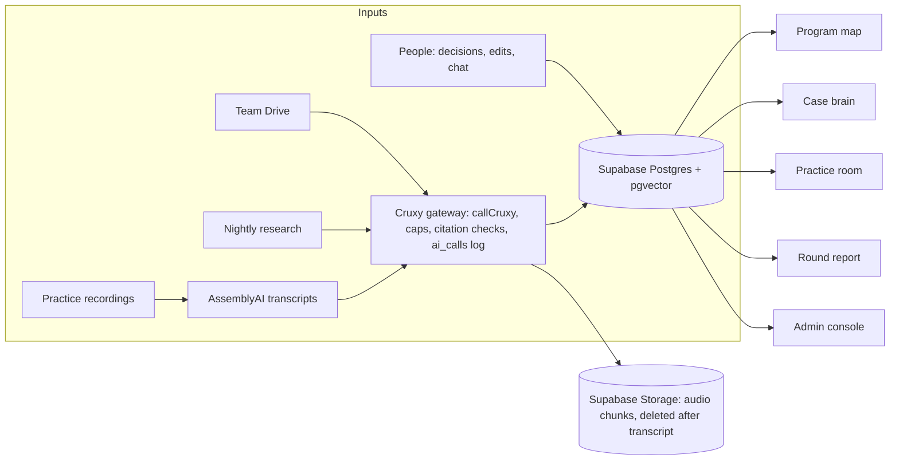

> Copy of the Claude Doc "Crux build spec" (exported Nov 21, 2026). If this file and the doc differ, the doc wins; re-export it here when it changes.

# Crux build spec

Nov 21, 2026 · @Jeh Jeh

Crux is a web app for USC's three Ethics Bowl teams that turns cases, notes, research and recorded practice into cited case maps, drills and graded rounds, ready for the regional on Dec 5, 2026 and used after it. Cruxy is its AI. Everything below is meant to be pasted into Bolt or Cursor in parallel tracks.

## How to build it

Build everything at once in seven parallel tracks that share one database and one design system. Start Track 0 first (a few hours), then run the other six side by side, each in its own Cursor or Bolt session.

| Track | What it builds | Sections | Tool |
| --- | --- | --- | --- |
| 0. Foundation | Next.js app, Supabase project, schema, sign in, roles, design tokens, activity log | Who uses it, Sign in, Data model, Privacy | Cursor |
| 1. Library | Drive sync, digesting, search, reading room with highlights and comments | Library, Research | Cursor |
| 2. Case brain | Claim maps, Truth Sources, Inspired by Team X, consistency checks | Case brain | Cursor |
| 3. Revision | One pagers, flashcards, Socratic drills, moderator bank, roadmap | Revision, Moderator bank, Roadmap | Bolt for screens, Cursor for logic |
| 4. Team space | Assignments, leads, team chat, Cruxy assistant | Assignments | Bolt for screens, Cursor for logic |
| 5. Practice | Sessions, judging portal, recording, transcripts, grading, feedback | Sessions, Practice, Judging, Feedback | Cursor |
| 6. Admin | Admin and coach console, spend caps, weekly summary | Admin console, Cost plan | Bolt |

Rules for every track:

1. Read this whole doc before writing code; paste the relevant sections into each session.
2. Every AI output stores the ids of the sources it used. No citation, no display.
3. Every AI call goes through one server function that logs tokens and cost and refuses calls over the cap.
4. Secrets live only in environment variables. Never paste passcodes or API keys into prompts or commit them.
5. Each track ends with the checks listed in Paste-ready prompts.

**Going fast.** Run the tracks as parallel agents (several Cursor windows or background agents, Bolt for screens built from the canvas), all sharing one types file and the schema from Track 0. Merge into main at least daily, and keep each track's checks green before merging. Cursor reads its context from the repo itself (AGENTS.md, .cursor/rules and docs/ in JainamTJain/Cruxy), so start each chat by mentioning AGENTS.md and the track's file in docs/tracks/, and update docs/spec.md there whenever this doc changes.

## Who uses it

There are four roles; everyone sees everything about every team, and only the two admins see codes, spend and the activity log.

| Role | People | Can do | Cannot do |
| --- | --- | --- | --- |
| Technical admin | Jainam | Everything below, plus everyone's passcodes (see and reset), spend caps, API keys, feeding books, the full activity log |  |
| Coach admin | Dr. B | See everything, create and run sessions, take attendance, see session codes, add moderator questions, get the weekly summary if she agrees | Change passcodes or spend caps, feed books |
| Member | Team 1: Serena, Ivan, Ashton, Stolei, Tri. Team 2: Lehar, Camerin, Jade, Bethany, Quixote. Team 3: Nick, Daniel, Katie, Jainam | Everything for their own team; read, comment on and borrow from every other team | Edit another team's Truth Sources, see session codes |
| Judge | Guests or members, per session | Score the session they were let into | See anything else |

Role rules:

- Team membership is set only by admins and can change at any time; history keeps the old team on old records.
- Jainam appears twice (technical admin and Team 3 member). His member view shows only what any member sees; the admin view is a separate switch.
- Leads, counter-arguers and supporters are case roles inside a team, set and changed by the team (see Assignments).

Dr. B can also switch to member view and use the whole platform herself: browse every team's case brains, readings, chats, practices and reports exactly as members see them, and run drills.

## Cruxy

Cruxy is the single name for every AI feature in Crux: it reads, researches, asks, plays opponents and moderators, judges, and coaches. Users never see the words "AI" or a model's name in the product.

How Cruxy behaves, in every feature:

1. **Cites or stays quiet.** Every claim it shows links to a source, a transcript timestamp or a Truth Source. If it has none, it says "I couldn't find a source for this."
2. **Honest over pleasant.** It names weak arguments plainly and never flatters. Praise is specific ("your thesis came at 0:22, under the 30 second goal").
3. **Builds your reasoning, doesn't replace it.** It asks before it tells; Socratic questions come first, model answers second and only on request.
4. **Even-handed.** It argues every side of a case at full strength, keeps its own politics out, and flags when an example leans one way.
5. **Shows where things came from.** Items carry a small origin tag: Cruxy, Dr. B, a team member, Inspired by Team 1, APPE, or the case set.
6. **Short.** Answers fit on a phone screen unless the user asks for more.

Where Cruxy shows up: a small mark next to anything it made, a floating Cruxy on every page that sleeps in its lamp, the chat drawer it opens (the assistant), and named roles in practice (Cruxy moderator, Cruxy opponent team, Cruxy judge).

What the consent screen says about Cruxy (plain words, shown at first sign in):

> Cruxy is Crux's built-in thinking partner. It would rather ask you a good question than hand you an answer. It reads our Drive and cases, finds new sources, asks practice questions, plays the other team or the judge when we need one, and gives feedback that quotes what you said. It can be wrong, so every answer shows its source and every new idea needs a person to accept it. It doesn't train on your recordings.

### Cruxy's character, floating Cruxy and the lamp

Cruxy is drawn as a small blue genie with a red feather, and lives in a blue and gold lamp. It is a wise, ethically careful learner: it asks more than it answers, and it gets better with every round.

**Character**

- **Asks first.** When someone asks for an answer, Cruxy first asks one question that moves their thinking ("What would the other side say?", "Which fact matters most here?", "Does that fit your principle in Case 12?"). It gives its full answer once the person has tried, asks a second time, or is short on time.
- **Answers directly** when asking would only waste time: lookups ("where is this in the Drive?"), schedule and logistics, admin questions, and anything during a timed round.
- **Hints one at a time**, never the whole answer at once.
- **Honest and kind.** Says when an argument is weak, never flatters, never pressures, and says plainly when it doesn't know.
- **Ethically careful.** Argues every side at full strength, keeps its own politics out, never shames a person, and never takes sides between the USC teams.
- **A learner.** Follows the reasoning standard and the improvement loop in Cruxy's agents, models and prompts.

**Floating Cruxy**

- Cruxy floats above every page, on computers and phones, with a gentle bob (still for people who turn on reduced motion).
- Drag it anywhere with a mouse, a finger or the arrow keys. Its spot is saved per person and device. On phones it snaps to the nearest edge so it never covers a button.
- Tap Cruxy to open the drawer with its current question. A short speech bubble shows one question at a time, with "One hint, please" and "Back to the lamp".
- During recording and timed rounds Cruxy hides automatically and only the lamp stays.
- A setting turns the floating figure off for a person; the lamp always stays.

**The lamp**

- The lamp sits at the bottom right of every page and is Cruxy's home.
- Cruxy goes to sleep in it when the person presses "Back to the lamp", drops Cruxy on the lamp, taps the lamp while Cruxy is awake, or does nothing for 5 minutes. It shows the sleepy pose for a moment, then disappears into the lamp, which shows "z z".
- Tap the lamp to call Cruxy. It comes back to its saved spot and opens with a question ("You called. What are you trying to figure out?").
- Asleep means quiet: no bubbles or pop ups. Reminders still go to the bell.

**Moods (nice to have)**

If moods are built, Cruxy swaps its picture when something happens, holds it for about 6 seconds, then goes back to curious. If they aren't built, Cruxy stays curious. The bubble text always says what happened, so the mood is never the only signal.

| Mood | File | Shows when |
| --- | --- | --- |
| Curious (default) | cruxy-curious.png | Asking a question |
| Listening | cruxy-neutral.png | While the person types, speaks or records |
| Hint | cruxy-winking.png | Giving one hint |
| Pleased | cruxy-happy.png | The person did better than their own past, or answered well |
| Excited | cruxy-excited.png | A personal best, or the team signs off a new version |
| Surprised | cruxy-surprised.png | A drift flag, a new source, or an unexpected judge comment |
| Sad | cruxy-sad.png | A round went worse than the person's own past; Cruxy then asks what they'd change |
| Sleepy | cruxy-sleepy.png | Going back to the lamp |
| Fierce | cruxy-angry.png | Only while Cruxy plays the other team in practice; never aimed at a person |

cruxy-lamp.png is Cruxy's small mark everywhere an icon is needed: the lamp at the bottom right, the Ask Cruxy button, the drawer header, chat messages and the phone tab. Never use a face-only crop of Cruxy. All are transparent PNGs that go in /public/cruxy/. The labels on the original poster were only for reference and are not part of the product. The interactive version is the Cruxy board on the design canvas.

Build note: one CruxyFloat component in the root layout holds position, asleep and mood. Position and asleep are saved in local storage and the person's profile. The app sends events (for example feedback.improved, version.signed\_off, drift.flagged) and a small table maps each event to a mood.

## Sign in, consent and attendance

The first time, everyone signs in with their name and a one-time starter code (the shared member code, or a starter admin code for Dr. B), then chooses their own 6 digit passcode, which they use from then on; attendance for group sessions is taken by an admin, with Cruxy pre-filling it.

**Sign in**

1. Pick your name from a list grouped by team (admins add names; no self sign up).
2. Enter your own 6 digit passcode on a keypad. The very first time, enter the shared member code (Dr. B: her starter code); after consent Crux asks you to choose your own passcode. An admin's passcode also opens the admin switch.
3. Stay signed in for 30 days on that browser; resetting someone's passcode signs that person out everywhere.
4. 5 wrong tries on one name locks it for 10 minutes and writes an activity log entry.
5. Store each personal passcode twice: an argon2 hash used to check sign in, and a copy encrypted (AES-GCM) with a key in the PASSCODE\_VIEW\_KEY environment variable, which only the technical admin's Passcodes panel can decrypt. Jainam's own admin passcode is set from an environment variable at deploy, is stored as a hash only, and is never shown anywhere.

**Choosing your own passcode**

- Right after consent on the first sign in (Dr. B included), Crux asks the person to choose a 6 digit passcode and type it twice.
- Refused: the shared member code, one digit repeated (111111), and straight runs (123456, 654321).
- The screen says plainly, before they choose: "Jainam, as technical admin, can see your passcode so he can help if you forget it. Don't reuse a code you use anywhere else."
- After that, the shared member code no longer signs that name in. People can change their passcode any time in Settings by entering the current one.
- Forgot it? The keypad shows "Forgot your passcode? Ask Jainam." He can tell them, or reset it, which gives them a new one-time code and asks them to choose again.

**The Passcodes panel (Jainam only)**

- In the admin console, a Passcodes panel lists everyone by team: passcode hidden as dots, when it was set, and last sign in.
- Show reveals one passcode for 20 seconds. The first reveal in 10 minutes asks Jainam to re-enter his own passcode.
- Reset gives that person a new one-time code and signs them out everywhere. The panel also changes the shared starter code for new members.
- Every reveal and reset goes in the activity log. Dr. B and members can't open the panel, and Jainam's own passcode never appears in it.

**Consent (first sign in only, re-shown if the wording changes)**

- One screen, plain words: what is recorded, when, why, who sees it, where it goes, how long it stays, and what Cruxy is.
- Two choices: "I agree to be recorded in practice" or "Not now: text only". Agreeing includes a 20 second voice sample, recorded right there, so transcripts can label who spoke.
- Text only members use everything except being recorded; a session that includes them shows a banner so the room knows.
- Consent, the date and the wording version are stored; anyone can change it in Settings; withdrawing deletes their voice sample.
- Dr. B's weekly summary email is a separate opt in on her first admin sign in.

**Attendance**

- Every session has an attendance list. Either admin can mark present, late or absent; members can tap "I'm here" on the session page.
- During a recorded session Cruxy pre-fills attendance from matched voices and joined devices; an admin confirms with one tap.
- Solo practice logs the person automatically. Attendance feeds the roadmap and the weekly summary.

**Reminders**

- In the app by default: a bell, the home screen and the roadmap.
- By email only if a person adds an email address and turns email reminders on. No calendar connection.

**First run**

- A 10 minute checklist on first sign in: confirm your cases and roles, open one reading, review 5 flashcards, answer one question out loud, and see your roadmap.
- One champion per team, chosen by the team, gets nudges when teammates haven't finished the checklist.

## Library and Drive sync

The Ethics Bowl Drive is Crux's base: every file in it is read once, sorted to the right case, broken into citable passages, and kept in sync, so Cruxy answers from your own material before anything else.

**Sync**

1. Jainam connects the Ethics Bowl Drive folder once (Google sign in for the Drive API, read only scope).
2. A nightly job and a "Sync now" button list every file in the folder tree, including Google Docs, PDFs, Sheets and Slides.
3. Only new or changed files are processed (compare Drive's modified time and checksum); unchanged files cost nothing.
4. Files added inside Crux (uploads, books) are also written back to a "Crux uploads" folder in the Drive, so the Drive stays the full archive.

**Digest (once per file version)**

1. Extract text: Docs and Slides via Drive export, PDFs via text extraction (scanned PDFs flagged for Jainam).
2. Sort: a small model tags each file with its cases (1, 3, 4, 5, 7, 9, 10, 11, 12, 13, 14, 15, or "general"), its type (case set, practice transcript, team notes, rules, research, coach guidance) and a confidence score. Under 0.7 goes to a sorting queue for Jainam.
3. Split into passages of about 600 words with page or heading anchors, embed each, and store them for search.
4. Extract from each file: ideas raised, who raised them, frameworks named, facts with sources, moderator style questions, and coach decisions. Ideas from practice transcripts become Truth Source proposals for the team that raised them.
5. Write a 5 line file card: what it is, which case, what's new in it, open questions.

**Reading room** (any time except while you are in a live practice)

- Open any case or resource full screen, with the case set page and the file side by side.
- Highlight text and leave a comment; highlights and comments are visible to all three teams, with names and team colours.
- Ask Cruxy about a highlight: "explain this", "find a counterexample", "is this cited elsewhere in our Drive?"
- Turn a highlight into a flashcard or a Truth Source proposal in one tap.
- Search across everything (passages, transcripts, Truth Sources, comments) with filters by case, team and type.

## Research

Cruxy researches each case every night, starting from what the Drive already holds, so new material fills real gaps instead of repeating what the team has; results are exhaustive in coverage and concise in what's shown.

**Nightly loop per case (batch mode, cheapest rates)**

1. Gap check: compare the case's claim maps across all three teams with the case set. List supports with no backing, outside facts not yet verified, counterclaims with no answer, and moderator questions with no prepared answer.
2. Search free sources for each gap (list in Stack): encyclopedias, academic indexes, court opinions, open books, recent news. Prefer the last 2 years for anything that changes; keep classics for frameworks.
3. Read the best 3 to 5 results per gap in full, not snippets.
4. Verify: every fact needs two independent sources or one primary source; mark single-source facts "needs check".
5. Write each finding as one card: the point in under 40 words, why it matters to which claim, the exact quote location, and the link.
6. Deduplicate against the library and against yesterday's findings.
7. Post cards to each team's Truth Sources queue as proposals, tagged Cruxy research.

**Exhaustive but concise**

- Coverage is measured: each case shows a research map of every claim, support and counterclaim with a filled, thin or empty dot.
- Display is capped: a finding card is at most 40 words; the full source is one tap away.
- Stop rule: a gap closes once it has two verified sources; Cruxy stops searching it.

**Books**

- When a gap points to a book the team doesn't own, Cruxy files a book request with the title, why it matters and the chapter.
- Only Jainam sees and handles book requests. He uploads the PDF, which goes to the Drive's Crux uploads folder and is digested like any file.
- Open books (public domain, open access) are fetched and digested automatically.

**Copyright rule:** Cruxy stores passages for citation inside Crux, shows short quotes only, and paraphrases the rest.

## Case brain and Truth Sources

Each team keeps its own case brain for each of the 12 cases: a claim map plus the Truth Sources behind it; every change any team makes reaches the other two as a proposal marked "Inspired by Team N", which they accept with ✅ or reject with ❌.

**What a case brain holds**

- Case card: facts from the case set with page numbers, the crux, the trap, stakeholders, likely moderator questions.
- Claim map: at least 2 claims, each with a logic line and 3 supports; each support with its backing (case fact, source, example or framework); at least 1 counterclaim with concede, distinguish and rebut. The same structure as the prep doc.
- Truth Sources: every fact, quote, example and framework the team has accepted, each linked to its passage, timestamp or page.
- Case roles: Lead 1, Lead 2, counter-arguer, supporter, shown at the top and editable by any team member (see Assignments).

**Likely opposing positions.** For each case, Cruxy builds the 3 or 4 positions other universities are most likely to present, each with its strongest support, its weak point, and two commentary angles. Teams add positions they hear at competitions. This is what the commenter prepares from.

**Proposals and decisions**

1. Proposals come from four places: practice transcripts, research, the reading room, and other teams' edits ("Inspired by Team 1").
2. Each proposal shows the idea, its origin tag, its source, and a one line Cruxy note only when there's a problem (unverified, contradicts a Truth Source, weak support). No note means it passed the acceptable, relevant, sufficient check.
3. A member decides with ✅, ❌ or edit, and must write a reason (one line minimum). Decisions are by anyone on the team.
4. Every team sees every other team's decisions and reasons next to the same idea, so disagreements are visible and useful.
5. Full history per item: who proposed, who decided, when, why, and every edit. Anything can be reopened.

**Socratic before borrowing.** Before a team decides on an "Inspired by Team N" proposal, Cruxy asks one question first ("Does this fit your Claim 2, or does it pull against your principle in Case 12?"), so teams think it through rather than copy.

**Robustness, kept current**

- A robustness bar per claim: supports backed, counterclaims answered, moderator questions answered, unverified facts open.
- Consistency check across cases: Cruxy flags when a team's principle in one case clashes with another case (for example, least restrictive tool in Case 12 versus Case 13), using the cross-case principles table.
- Change the facts check: Cruxy lists the single facts that, if changed, would flip each claim, so the team prepares those answers.

## Revision

Revision tools are generated from each team's own Truth Sources, so what people memorize is exactly what the team agreed on, and they refresh when the Truth Sources change.

**One pagers**

- Cruxy drafts each team's one pager per case from its claim map, in the 2 claims, 3 supports, counterclaim format. The team edits it; Cruxy only re-drafts on request.
- Shown as a printable page and exported to the Drive as a Google Doc and PDF.
- A diff view shows what changed since the last version and who changed it.

**Visual one pagers.** One pagers are built to be seen, not just read: the claim map as connected boxes, a values-in-tension scale, a stakeholder grid, a timeline of the case facts, a framework strip with one line each, and a table of likely questions with our one line answers. Cruxy picks the visual for each part and the team edits it. There is no limit on how much Cruxy drafts; the team signs it off.

**Flashcards**

- Generated from readings, Truth Sources and the case card: facts with page numbers, claims and their logic lines, frameworks in one sentence, counterclaim responses, and change the facts answers.
- Assigned by role: leads get their cases' decks automatically. Anyone else can add any deck, and their profile shows "studying Case 9 (not assigned)".
- Spaced repetition: cards come back sooner when missed (SM-2 or FSRS scheduling), and answers can be typed or spoken.

**Socratic drills**

- Cruxy asks one question at a time aimed at the weakest link in the claim map, then follows up on the answer ("why does that follow?", "what would your opponent say?").
- Ends with a 3 line summary of what held and what didn't, linked to the claim map.

**Language and analogies**

- For each claim, Cruxy suggests: a plain sentence version under 25 words, 2 everyday analogies, 1 vivid example from the Truth Sources, and phrases to avoid (jargon, hedges, loaded words).
- Members save their favourite phrasings to their personal phrasebook.

**Warm ups**

- A 10 minute warm up for the morning of a round: 5 flashcards, 2 moderator questions answered out loud, 1 counterclaim rebuttal, on cases picked at random.

## Moderator question bank

One bank per case, shared by all teams, where every question shows who wrote it (Dr. B, Cruxy, a member, or from a real round) and Cruxy keeps adding questions aimed at whatever the teams answer worst.

- **Dr. B adds freely.** She can paste unstructured text (an email, a list, a voice note transcript); Cruxy splits it into single questions, tags each with its case, type and difficulty, and shows the result for her to confirm.
- **Cruxy adds** using the five question types judges are trained to ask: follow ups on skipped issues, pushback on our own view, the other team's points re-asked, change the facts hypotheticals, and "state your view and main reasons". It also writes the case's own closing question in several wordings.
- **Members add** questions they heard or imagined; real regional questions get the tag "Asked at UCSB" afterwards.
- **Difficulty** 1 to 3, set by Cruxy and corrected by how people actually score on it.
- **Random serve** in drills and practice: weighted toward unseen questions, questions you scored low on, and your cases; never the same question twice in a session.
- **Answer log:** every answer (spoken or typed) is kept with its score and feedback, so the bank shows each question's best team answer, linked to its timestamp.
- **Robustness meter per case:** share of bank questions each member now answers better than their own first attempt, per team.

## Personal roadmap and deadlines

Every person has their own roadmap: one track per case, seven stages, recommended deadlines counted back from the competition date, and progress filled in automatically from what they actually do in Crux.

**Stages and how each is marked done**

| Stage | Done when | Required for |
| --- | --- | --- |
| Read | Case set page and every file Cruxy tagged "core" opened for at least 60% of reading time | Everyone, all 12 cases |
| Map | Person has contributed to or reviewed every claim on their team's map | Leads, counter-arguer |
| One pager | Team one pager has no empty rows and the person has signed it off | Leads, supporter |
| Flashcards | 90% of the case deck recalled correctly twice | Leads; anyone who opts in |
| Question drill | 10 bank questions answered, with your average above your own first attempts on this case | Leads, counter-arguer |
| Practiced | Spoke in at least one recorded round on the case | Everyone with a role on it |
| Judged | Judged at least twice (human or Cruxy judge), with your latest score above your own earlier one on this case | Leads |

**No fixed score cutoffs anywhere in Crux.** Every threshold compares a person with their own past (their first attempt, recent average or best), never with a set number or with other people. Judges still score on the APPE 1 to 10 scale, because that is how the regional is scored; progress, stages and "weak" flags are always measured as change from the person's own history.

**Recommended deadlines (default for the December 5 regional; each team can edit theirs)**

| Stage | Recommended by |
| --- | --- |
| Read all 12 cases | Nov 24 |
| Map own cases | Nov 25 |
| One pagers | Nov 28 |
| Flashcards | Dec 2 |
| Question drill | Dec 2 |
| Practiced | Dec 3 |
| Judged | Dec 4 |

The defaults leave Thanksgiving (Nov 26) light. For any later competition an admin enters the date and the defaults re-space themselves across the time available.

**What the roadmap shows**

- A track per case with seven stations, a "today" line and a flag on each deadline; stations fill as work happens, and overdue ones turn red.
- A readiness number per case (share of required stages done, weighted toward judged and practiced) and per team.
- "Do next": the three most useful actions for this person today, picked from overdue stages, weak feedback areas, and assignments.

## Assignments, team chat and the Cruxy assistant

Teams split work with an Assign button that takes two taps to change, talk in a team chat everyone can read, and can ask Cruxy for help from a drawer on every page.

**Assign**

- An Assign button on every case, flashcard deck, one pager, reading and practice slot. Pick a person (or several), a role or task, and an optional due date.
- Case roles (Lead 1, Lead 2, counter-arguer, supporter) are set per team per case; any team member can change them, in two taps, from the case brain or the team board. The change is logged and announced in team chat.
- Everything assigned appears on the person's profile and roadmap, with who assigned it.
- A team board shows the 12 cases by role and person, so gaps (a case with no lead) are visible at a glance.

**Team chat**

- One channel per team plus one all-program channel; every channel is readable by everyone; posting is for members of that team (admins can post anywhere).
- Messages can mention people, link a case, a passage, a timestamp or a Truth Source.
- Chat does not create tasks by itself; assignments stay explicit.

Any chat message can be marked "idea" and sent to the team's Truth Sources queue, so discussion becomes structured instead of scattered.

**Staying on the same page**

Each team keeps one current version of its position on every case, and Crux keeps every member's understanding in step with it as ideas change.

- **One current position per case.** The claim map is versioned (v1, v2, ...). Any change to a claim, logic line or counterclaim response creates a new version with a one line "what changed and why", written by whoever changed it.
- **Changes reach everyone.** A new version posts to team chat and to each member's home screen as a short diff (old wording struck through, new wording shown).
- **Read and confirm.** Each member taps "I've got v7" after reading the diff. The case board shows who is still on an older version; a session start warns the admin if anyone in that round hasn't confirmed.
- **Alignment check.** After a change, Cruxy asks each member 2 or 3 quick questions ("What is our Claim 2 now?", "How do we answer Waldron?"). Answers that drift from the current version are flagged to that person and the leads, privately at first.
- **Drift in practice.** In transcripts, Cruxy flags lines where someone argues an older version or contradicts the current one ("Katie used the v5 wording of C2 at 12:40"), and links the current wording.
- **State of the case, out loud.** Every team session can open with a 2 minute read-aloud of the current one pager by the supporter, so the room starts from the same version.
- **Bigger changes need two people.** Changing a claim itself (not its supports) needs the lead plus one more team member to accept, so a position never shifts on one person's say-so.

**Cruxy assistant (drawer on every page)**

- Knows where you are (case, page, highlight) and answers from your team's Truth Sources first, then the library, then the web, citing each.
- Can: explain a passage, quiz you, find a source, draft a one pager row for your review, summarize what changed since your last visit, and tell you what to do next.
- Won't: decide Truth Sources, change roles, or speak for the team.
- Follows the Cruxy rules (cites, honest, even-handed, short) and has its own mark and colour so it is recognizable.

**Cruxy for admins (Jainam and Dr. B)**

In the admin view, the same drawer answers questions about the whole program from live data, and every answer links to the screens and records behind it.

- **What's happening where:** "What did the teams do this week?", "Which sessions ran today and who came?", "What changed in Case 12 since Monday?"
- **Who is prepared:** "Who is ready to lead Case 9?", "Who hasn't practised Case 5?", "Who is behind their roadmap?" Readiness here means progress against each person's own path and history, not a fixed bar.
- **Which team needs help:** "Which team is weakest on Case 13, and why?", "Where do the teams disagree?", "Which cases have no counterclaim answered?" Cruxy names the gap, the people involved and one suggested next step (a session, a drill or a pairing).
- **Before a competition:** "Give me a readiness brief for Dec 5" returns a one page summary by team and case, with risks first.
- It answers only from Crux's own records (roadmaps, attendance, scores, Truth Sources, chat), shows the numbers it used, and says when data is missing. Members can't use this mode.

## Sessions

A session is one practice event; admins set up group days in advance, and teams can also practise alone or with another team at any time, outside admin sessions, with no admin needed; everyone who joins is taken straight to the screen for their part.

**Admin set up (Jainam or Dr. B)**

1. Date, time, place or online.
2. The day's split: one or more rounds, each with a case, the teams in it, who presents and who comments, and timings (defaults follow the regional rules: presentation 7 to 12 minutes, commentary 5 to 8, Q&A 10 to 15; edit per round).
3. Who moderates: a person (named) or the Cruxy moderator.
4. Who judges: any number of human judges, the Cruxy judge, or both. When no human judge is present, Cruxy judges every team in the round.
5. Crux creates a session code. Only admins see it.

**Joining**

- Members see today's sessions on their home screen and tap Join; Crux sends them to the presenter, commenter, observer or moderator screen for their round.
- Online members join from a link and record from their own device.
- The admin's session screen shows who joined, attendance, the round clock, and a "Next round" button.

**Judging portal (replaces the QR-only flow)**

1. When a round starts, Crux asks the admin: who is judging? In person, Cruxy judge, or both.
2. In person, then: someone already in Crux, or someone new?
3. Someone in Crux (a member or a returning judge) opens the Judging portal, enters the session code the admin reads to them, and lands on the scoring card for that round.
4. Someone new scans a QR code on the admin's screen, types their name and judging background, and lands on the same scoring card. No account needed.
5. Behind the scenes both paths attach the card to the right session, round and teams; the admin sees each judge's card arrive.

**Practice outside admin sessions (no admin needed)**

- Any member can start a practice from the Practice page at any time: solo, with their own team, or with another team.
- Invite another team (or named people from it); they get a notice on their home screen and accept in one tap. Online members join from a link.
- The starter picks the case, mode and timings, and who moderates and judges: a member from any team through the Judging portal, the Cruxy moderator, the Cruxy opponent team, the Cruxy judge, or none.
- Attendance is logged from who joined; no admin confirmation is needed.
- Recordings, transcripts, reports, redos, Truth Source proposals and roadmap progress work exactly as in admin sessions.
- Admins see these practices on the program map and in the activity log, but they don't have to set them up or approve them.

## Practice and recording

Practice runs in the browser in six modes, records from one shared device or from everyone's own device, and ends with a transcript that names each speaker; the audio is deleted as soon as the transcript is saved.

**Modes**

| Mode | What happens | Who plays the other side |
| --- | --- | --- |
| Full round | Presentation, commentary, response, judges' Q&A, timed to the round's settings | Another team, or Cruxy as the other team |
| Moderator drill | Random bank questions read aloud; answer out loud within a set time | Cruxy moderator |
| Commentary drill | Cruxy presents a case position for 7 to 12 minutes; you deliver commentary on it | Cruxy as the presenting team |
| Judges' Q&A drill | Rapid follow ups, pushback and change the facts questions on your own claims | Cruxy judge panel |
| Solo speech | Deliver your part (a claim, the intro, the counterclaim) and get it scored | None |
| Free record | Record any discussion; Cruxy pulls out ideas for Truth Sources | None |

"Cruxy as the other team" means Cruxy writes and reads aloud the other team's presentation or commentary, built from the strongest opposing view in all three teams' case brains, and shows its text on screen.

**More drills for the round itself**

- **Conferral drill:** an unseen question, 60 seconds to confer with scratch paper only (as the rules allow), then answer. Crux times it and checks who spoke.
- **Thesis in 30 seconds:** a fresh wording of a case question; answer in one sentence. Times are tracked against your own past times.
- **Q&A routing:** each team sets who takes which kind of judge question (facts, framework pushback, change the facts, practical). Reports check whether the right person answered.

**Phones (still web only)**

- Every screen works on a phone browser; Crux can be added to the home screen like an app.
- Recording is tested on iPhone Safari and Android Chrome before release.
- Captions: live captions during practice, and everything Cruxy says aloud also appears as text.

**Devices**

- One device in the room: one microphone; speakers labelled from voice samples and round roles; an admin confirms labels on one screen after.
- Everyone on their own device: each device records its owner, so labels are exact; best for online sessions.
- Mixed is allowed; Crux lines recordings up by timestamps.

**Recording pipeline**

1. Browser records in 30 second chunks and uploads each chunk as it goes, so a crash loses at most 30 seconds.
2. Optional free live captions in Chrome from the browser's speech recognition (rough, on screen only).
3. At the end, the full audio goes to the transcription service with speaker labels and word timestamps.
4. Speakers are matched to people; the transcript is stored with every line timestamped.
5. The audio file is deleted immediately after the transcript is saved. Only text remains.

**Transcription vocabulary**

1. A glossary is built automatically per case from the case set, the Drive and the Truth Sources: philosophers, court cases, laws, organisations, places, coined terms (Nozick, Brandenburg, Kalshi, NAGPRA, looksmaxxing), plus every member's name and team names.
2. Each round sends that case's glossary and the names of the people present to the transcription service as key terms.
3. A correction pass then fixes glossary words from context, marks every correction, and flags uncertain words for a quick check. It never changes meaning.
4. When anyone fixes a word in a transcript, the correct term and the misheard form are added to the glossary, so the next transcript gets it right.
5. Unusual names get a pronunciation note taken from each person's voice sample.
6. Quality check: Jainam sees an accuracy estimate on glossary terms per round, and a short test clip per case is re-run whenever the glossary changes.

**In the room**

- Phase strip with the round clock; a hard stop at time ("that's time"), as at the regional.
- A red recording bar on every participant's screen while recording.
- Talk analytics per person: talk time, words per minute, filler words, time to first answer, and interruptions.

## Judging and calibration

Human judges and the Cruxy judge fill the same APPE scoring card; Cruxy analyses every human card before letting it tune Cruxy's own scoring, because a judge's scores carry more than skill (mood, fatigue, a lean toward one side of a case); none of this analysis is shown to members.

**The scoring card: a copy of the one in your Drive (same for humans and Cruxy)**

- **Built from the Drive.** The Librarian reads the APPE IEB Fillable Scoring Sheet (August 2020) in the Drive's Training Documents folder and builds the card from it: the same items, the same question wording, the same order, the same 1 to 10 scales and the same totals. The score bands and the Guide to Scoring from the same folder sit beside the card as a judge's guide. If a newer sheet appears in the Drive, Crux shows Jainam the differences and switches after he confirms.
- **Laid out like the paper sheet.** One card per judge per round, with a column for each team, so the judge scores both teams side by side, as on the original:

| Item | Question on the sheet | Team A | Team B |
| --- | --- | --- | --- |
| Presentation A | Was the presentation clear and systematic? | 1 to 10 | 1 to 10 |
| Presentation B | Did the presentation clearly identify and thoroughly discuss the central moral dimensions of the case? | 1 to 10 | 1 to 10 |
| Presentation C | Did the presentation show awareness of and thoughtful consideration for different viewpoints, especially those that would weigh heavily for those who disagree? | 1 to 10 | 1 to 10 |
| Presentation total | A + B + C | 3 to 30 | 3 to 30 |
| Commentary | The team's commentary on the other team's presentation | 1 to 10 | 1 to 10 |
| Response to commentary | The team's response to the other team's commentary | 1 to 10 | 1 to 10 |
| Response to judges | The team's answers to the judges' questions | 1 to 10 | 1 to 10 |
| Team total | All of the above | up to 60 | up to 60 |

- **Spirit points (1 to 5)** go on a separate feedback sheet, as in the APPE materials, with its own comment box.
- **Comments and moments.** A comment box per item and an overall comment, as on the sheet; humans can also tap "mark this moment", which pins a note to the transcript time.
- **Rounds with one presenting team** (solo or a team against Cruxy) show only the columns and items that apply, with the rest marked "not scored this round".
- **The Cruxy judge fills the identical card**, adding 1 to 3 quoted lines as evidence for each score.

**The Cruxy judge**

- Scores every item with 1 to 3 quoted lines and their timestamps as evidence; any score without evidence is not shown.
- Asks judges' Q&A questions out loud in Cruxy judge mode, one question and one follow up per judge seat, as the rules describe.
- Before any human cards exist, it is grounded in the APPE Guide to Scoring, the score bands, the judges' question guide, your Nationals notes and Dr. B's practice guidance from the Drive.

**Peer judging of recordings.** Any member can judge another team's recorded round later, on the same card, from its transcript. Peer cards count as judged rounds for the speakers and go through the same analysis before they tune Cruxy.

**Predict your score first.** Before a speaker opens their report, they guess their own score on each item. The gap between guess and score is tracked over time as a skill of its own.

**Calibration (internal)**

1. **No fixed weights.** A judge's background (past APPE judge, faculty, debater, team member) is only a starting guess, and each card's influence is decided afresh from evidence.
2. **Analyse the card first.** Before using a card, Cruxy checks it against the transcript and writes a short note:
   - **Evidence:** do the judge's comments point to things that were actually said, and do the scores match the comments?
   - **Position lean:** do scores follow whether the judge agrees with a team's conclusion rather than the quality of its reasoning? Judges are told to separate the two, so Cruxy compares scores with how each side's reasoning held up.
   - **Drift:** does this judge score harsher or kinder as the session goes on, late at night, or after a long day? Cruxy compares rounds within the session and with the judge's earlier cards.
   - **Agreement:** where there are other judges, how far apart are they, and on which items?
   - **Conflicts:** is the judge a member of a competing team, or have they argued a side of this case themselves?
3. **Decide what to learn.** Each item on the card is then used fully, used with less influence, or kept as feedback for the speakers only and left out of calibration, with the reason recorded.
4. **Update slowly.** Cruxy's correction for each scoring item moves only when several analysed cards agree, so one unusual round can't swing it.
5. **Worked examples.** Rounds whose cards passed the analysis well become worked examples the Cruxy judge reads before scoring similar rounds.
6. **Who sees what.** Members see scores and reasons only. The technical admin sees each card's analysis note, what was used and why, and can override a decision.

## Feedback reports and the bank

Every round produces one report with a team section and a personal section for each speaker; every point quotes what was said, explains why it matters, shows a better version, and ends in a short redo that is scored again, so feedback turns into practice rather than reading.

**Report, top to bottom**

1. **Headline:** the round's result and the single biggest fix, in one sentence.
2. **Scorecard:** each item with Cruxy's score and every human judge's score side by side, and one line of reasoning per item linked to its timestamp.
3. **Each person, in their own section** (visible to everyone):
   - What worked: one or two quoted moments and why they scored.
   - The one thing to fix: the quote and timestamp; the scoring item it cost; why, in two or three sentences of reasoning a judge would recognise; and what the audience likely heard.
   - The better version: the same moment rewritten in their own style, under 40 words.
   - Redo now: a 60 to 90 second re-take of that moment, recorded on the spot and re-scored. It stays open until it scores higher, and it returns in their drills over the next week.
   - Talk analytics: talk time, pace, filler words, time to first answer.
4. **Transcript:** full, speaker labelled, with every feedback point pinned to its line.
5. **Socratic follow ups:** two or three questions to answer before the next round.
6. **New ideas:** ideas raised in the round, already sent to the team's Truth Sources queue.

**Reinforcement**

- Each person has a skills chart (answer first, explain frameworks, engage objections, stay under time, commentary focus) that updates after every scored redo and round.
- A skill that doesn't improve on the person's own recent average for two rounds becomes a roadmap task with a specific drill.

**Things to take care of (the bank)**

- Cruxy proposes a bank entry when the same issue appears in two or more rounds, or a human judge writes it; an admin or any member adds it with one tap.
- Every entry has: the lesson in one line; a vivid real example (quoted line, speaker, team, case, timestamp); why it cost points (the scoring item and any judge comment); the improved version; a linked drill to practise it; and how often it has been seen.
- Members can mark "I do this" to add the drill to their own roadmap.

## Program map, admin console and weekly summary

Everyone lands on a program map that shows what the whole program has built so far; admins also get a console to run people, sessions, codes and spend.

**Program map (everyone's launch screen)**

- A 12 case by 3 team grid: each cell shows readiness, the case's leads, and the latest event ("Team 2 graded 41/60 yesterday").
- Running totals that grow: Drive files digested, passages cited, ideas accepted, sources verified, questions in the bank, rounds graded, redo improvements.
- What changed since your last visit, across all teams, newest first.
- Days to the next competition, and your own top three next actions.

**Admin console (Jainam and Dr. B)**

| Area | Jainam | Dr. B |
| --- | --- | --- |
| Teams and people: add, move, remove | Yes | Yes |
| Sessions: create, run, see codes, take attendance | Yes | Yes |
| Moderator questions: add, edit | Yes | Yes |
| Consent status per person | Yes | Yes |
| Program analytics: readiness, attendance, score trends per person and team | Yes | Yes |
| Passcodes (Jainam only): see or reset anyone's passcode, change the shared starter code | Yes | No |
| Spend: caps, ledger by feature, pause research | Yes | No |
| Book requests and the Drive sorting queue | Yes | No |
| Calibration view: judge weights, Cruxy score gaps | Yes | No |
| Activity log: every sign in, edit, decision, recording, failed passcode | Yes | Read only |

**Weekly summary for Dr. B (Sunday 6 pm, only if she opted in)**

- One email: attendance by person, rounds and scores by team, biggest improvements, cases at risk (low readiness near a deadline), open disagreements between teams' Truth Sources, and Things to take care of added that week.
- Each line links into Crux. Jainam gets the same email plus spend and errors.

**Is Crux working? (Jainam only)**

- Use against improvement: do people who drill, redo and read more improve faster on their own scores?
- Which features are used, by whom, and which are ignored; which Cruxy outputs are marked useful.
- Shown only on Jainam's portal.

**Competition log and next season**

- During and after each competition, a quick log per round: case, opponent, moderator question, judges' questions, judge comments, scores and result. Real questions enter the bank tagged "Asked at UCSB".
- Season rollover: archive the season to the Drive, import the next case set, add or move members, reset roles and roadmaps, and keep the Things to take care of bank, Cruxy's example library and the glossary.

## Architecture



Every input reaches the database only through the Cruxy gateway, which is where spend caps and citation checks live; what people do on screen (decisions, edits, recordings) writes back into the same database, so all three teams always see one current picture.

## Data model

One Postgres database (Supabase) holds everything except raw files; every row has id, created\_at, created\_by and, where it applies, team\_id and case\_id, so any screen can filter by team and case.

| Table | Key columns | Notes |
| --- | --- | --- |
| people | name, team\_id, role (member, coach\_admin, tech\_admin), consent\_version, consent\_at, recording\_ok, voice\_sample\_path, digest\_opt\_in | Team history kept in team\_memberships |
| teams, team\_memberships | name, colour; person\_id, team\_id, from, to |  |
| auth\_codes | kind (starter, personal, admin), person\_id, hash, encrypted\_copy (personal only), must\_choose (bool), set\_at, last\_revealed\_at | Hash to check; encrypted copy only for the technical admin to view; Jainam's own is hash only |
| competitions | name, date, place, timings | Drives deadlines and round defaults |
| cases | number, title, case\_set\_page, crux, trap, closing\_question, active | Cases 2, 6, 8 inactive for California |
| files | drive\_id, path, mime, modified\_at, checksum, case\_ids\[\], type, confidence, card | One row per Drive file version |
| passages | file\_id, anchor (page or heading), text, embedding vector | Search and citations |
| highlights, comments | passage\_id, range, person\_id, body, thread\_id | Reading room, visible to all |
| claims, supports, backings, counterclaims | team\_id, case\_id, text, logic\_line, order, citation\_ids\[\] | The claim map |
| truth\_items | team\_id, case\_id, kind (fact, quote, example, framework), text, citation\_ids\[\], status | Accepted items |
| proposals | team\_id, case\_id, origin (transcript, research, reading, inspired\_by\_team), origin\_ref, text, cruxy\_note, status | Queue items |
| decisions | proposal\_id, person\_id, verdict (accept, reject, edit), reason (required), edited\_text | Visible to all teams |
| case\_roles, assignments | team\_id, case\_id, person\_id, role; task, due, assigned\_by, status |  |
| one\_pagers, flashcards, card\_reviews | team\_id, case\_id, version, body; deck, front, back, citation\_ids\[\]; person\_id, card\_id, grade, next\_due | Spaced repetition |
| questions, answers | case\_id, text, type, difficulty, origin (dr\_b, cruxy, member, asked\_at\_round); question\_id, person\_id, transcript\_ref, score, feedback | Moderator bank |
| sessions, rounds | date, place, online, code\_hash, created\_by; session\_id, case\_id, teams, sides, moderator, judges, timings | Codes hashed, shown to admins only |
| attendance | session\_id, person\_id, status, source (admin, self, voice) |  |
| recordings | round\_id, chunk\_paths\[\], status, deleted\_at | Rows stay, audio deleted |
| transcript\_lines | round\_id, start\_ms, end\_ms, speaker\_person\_id, text | Every citation into practice points here |
| judges, judge\_cards, card\_scores | name, background, weight; round\_id, judge\_id or cruxy, team\_id; item, score, comment, evidence\_line\_ids\[\] |  |
| feedback\_items, redos | round\_id, person\_id, kind, quote\_line\_id, reasoning, better\_version; feedback\_item\_id, transcript\_ref, score\_before, score\_after |  |
| bank\_entries | lesson, example\_line\_id, why, improved, drill\_id, seen\_count | Things to take care of |
| roadmap\_stages | person\_id, case\_id, stage, required, due, done\_at |  |
| chats, messages | channel (team or program), person\_id or cruxy, body, refs\[\] |  |
| research\_runs, book\_requests | case\_id, gaps\[\], findings\[\]; title, reason, chapter, status | Book requests visible to Jainam only |
| ai\_calls | feature, model, tokens\_in, tokens\_out, cost\_usd, person\_id | The cost ledger |
| activity\_log | person\_id, action, target, ip\_hash, at | Admin view |

Row level security: everyone can read everything except auth\_codes, session codes, ai\_calls, book\_requests and judge weights; writes are limited to your own team's rows, except comments and chat.

## Cruxy's agents, models and prompts

Cruxy is eight narrow agents behind one name, each with its own prompt and output schema; cheap models do the reading and sorting, a strong model does judging, opposing and coaching, and every output is checked for citations before anyone sees it.

| Agent | Job | Model tier | Runs |
| --- | --- | --- | --- |
| Librarian | Sort files, split passages, write file cards, extract ideas | Small | On sync, batch |
| Researcher | Find gaps, search, read, verify, write finding cards | Small for search and reading, strong for verification | Nightly, batch |
| Analyst | Check proposals (acceptable, relevant, sufficient), consistency across cases, change the facts list | Strong | On each proposal |
| Coach | One pagers, flashcards, Socratic drills, language and analogies | Small for cards, strong for Socratic | On demand |
| Moderator | Pick and phrase bank questions, write new ones | Small | On demand, nightly |
| Opponent | Write and read the other team's presentation or commentary | Strong | Practice |
| Judge | Score cards with evidence, ask Q&A questions, write reports and redos | Strong | After each round |
| Assistant | The chat drawer | Small by default, strong when asked to reason | On demand |

**Model routing.** Call every model through one gateway (the Vercel AI SDK with AI Gateway, or OpenRouter) so models can be swapped from an admin setting without code changes. Use paid tiers that don't train on your data for anything containing transcripts.

**Context packing (the main cost and quality lever)**

- Never send the whole library. Each call gets: the Cruxy rules, the case card, the relevant claim map nodes, and the top 8 to 12 passages by search, about 6,000 to 12,000 tokens.
- The Cruxy rules and case card are a fixed prefix, so prompt caching applies.
- Transcripts are sent whole only to the Judge, once per round.

**Output rules**

- Every agent returns JSON in a fixed schema; every claim carries citation ids (passage, transcript line or truth item).
- The server checks that each id exists and that a quoted string appears in the cited text; anything failing is dropped and logged.

**Shared system prompt (start of every call)**

> You are Cruxy, the assistant inside Crux for USC's Ethics Bowl teams. Use only the sources provided, and cite their ids for every claim. If the sources don't support an answer, say so. Be honest and specific; never flatter. Argue every side at full strength and keep your own political views out. Ask before you answer: start with one question that builds the student's reasoning, give hints one at a time, and give your full answer only after they have tried or ask again, unless it is a lookup, logistics, an admin question or a timed round. Keep it short. Ethics Bowl is about ethics, not law or policy: bring legal points back to the moral question. Reason the way the reasoning standard below sets out, and judge every argument by it.

**The reasoning standard (taught to every agent)**

Cruxy is given one explicit method for logic and ethics, the same one the team uses, and is graded against it so it gets better with every practice.

- **Logical structure:** claim → logic line ("because S1, S2 and S3, therefore the claim") → three supports, each with backing → at least one counterclaim answered by concede, distinguish or rebut. Every support passes the acceptable, relevant, sufficient test; if the supports could all be true and the claim still false, a support is missing.
- **Ethical analysis:** name the values in tension, the stakeholders (including the voiceless), one or two frameworks explained in plain words with their limits, principle and consequences together, and what we concede.
- **Stress tests:** counterexample, flip test, slope test, second order effects, and change the facts.
- **Checks Cruxy runs on any argument:** a catalogue of common fallacies (false dilemma, slippery slope without a stopping point, post hoc, appeal to authority, equivocation on a key term), circular supports, unexplained theory, and a gap between principle and case facts.

**How it improves with practice**

1. **Growing example library.** Arguments that held up (accepted claim maps, moments judges praised, redos that scored higher) are stored as worked examples; weak ones are stored with what went wrong. Agents read the most similar examples before they work.
2. **People grade Cruxy.** Every critique, Socratic question and model answer has "useful" and "not useful" buttons with an optional reason; leads and admins can mark a Cruxy point as wrong.
3. **Outcomes grade Cruxy.** Cruxy's advice is checked against what happened next: did following it raise the person's next score, and did judges later agree?
4. **A fixed test set.** A set of past transcripts and arguments with agreed critiques is re-run whenever prompts or examples change; a change ships only if Cruxy does at least as well on it.
5. **Weekly review.** Cruxy drafts updates to its examples and checks from the week's feedback; the technical admin approves them in the console.

None of this is described on the consent screen.

**Judge prompt additions**

> Score each item on the APPE card from 1 to 10 using the score bands and the Guide to Scoring provided. For each score give one to three quoted lines with their ids as evidence. Separate a logical flaw from disagreement with the conclusion. Then, for each speaker, give one thing that worked, the one thing to fix, why it cost points, a better version under 40 words in their style, and a 60 to 90 second redo prompt. Worked examples from calibrated rounds follow. Fill the card exactly as built from the Fillable Scoring Sheet in the team's Drive: same items, wording, order and scales.

## Cost plan and caps

The whole app should run on about $15 to $30 a month after free credits, with hard caps so it can never exceed $30; transcription and judging are the two real costs.

Assumptions: 55 hours of recorded practice a month (3 teams, 3 sessions a week, 1.5 hours each) and about 40 graded rounds or drills. These are estimates; prices below are as listed in November 2026 and should be checked before paying.

| Item | How it's priced | Monthly estimate |
| --- | --- | --- |
| Transcription with speaker labels | AssemblyAI Universal-3.5 Pro at $0.21 an hour plus $0.02 for speaker labels and $0.05 for key terms (Universal-2 at $0.15 an hour for solo drills) ([pricing](https://www.assemblyai.com/pricing.md)); $50 free credit at sign up | About $9 to $15; the first months are covered by the credit |
| Drive digesting (one time, then changes only) | Small model, such as Gemini Flash-Lite at $0.25 per million input tokens ([pricing](https://ai.google.dev/pricing)) | Under $1 once; cents after |
| Judging and reports | Strong model, one call per round with the whole transcript | About $4 to $15 |
| Nightly research | Small model in batch mode, strong model only to verify | About $2 to $5 |
| Assistant, drills, flashcards | Mostly small model | About $1 to $3 |
| Hosting, database, email | Vercel and Supabase free tiers; a free email service tier for the weekly summary | $0 at this size |

Backups for transcription: Deepgram gives $200 of free credit ([pricing](https://www.deepgram.com/pricing)); Groq's Whisper turbo costs $0.04 an hour but has no speaker labels, so use it only for solo speeches ([pricing](https://console.groq.com/docs/model/whisper-large-v3-turbo)).

**Caps (enforced in the one AI gateway function)**

- Monthly hard cap: $30. At 80% Jainam gets an alert; at 100% everything except reading and flashcard review pauses.
- Per round cap: $0.75. Per research night: $0.25. Per person per day for the assistant: $0.20.
- Every call is logged in ai\_calls; the admin console shows spend by feature and by person.

**What keeps it cheap:** digest once and only re-digest changed files; search before sending context; cache the fixed prompt prefix; batch overnight work; delete audio after transcription; never send a whole library.

## Stack, services and repos

Use Next.js on Vercel with Supabase; everything else is a free API or a pay per use service behind the one AI gateway.

| Layer | Choice | Why |
| --- | --- | --- |
| App | Next.js (App Router, TypeScript), Tailwind, shadcn/ui as a base restyled to the Crux look | Bolt and Cursor both handle it well |
| Hosting | Vercel | Already connected; cron for nightly jobs |
| Database, files, search | Supabase: Postgres with pgvector, Storage for audio chunks, row level security, scheduled functions | One service for data, files and search |
| Drive | Google Drive API, read only, through the service account crux-drive-reader (Google Cloud project crux-ethics-bowl-jainam-jain), which the Ethics Bowl folder is shared with | Base library |
| Transcription | AssemblyAI Universal-3.5 Pro (speaker labels, key terms, word timestamps); Universal-2 for solo drills | Cheapest with labels |
| Models | Through the Vercel AI SDK and AI Gateway, or OpenRouter | Swap models without code changes |
| Embeddings | A small embedding model through the same gateway, or Supabase's built-in embedding function | Cheap search |
| In browser | MediaRecorder for audio, SpeechSynthesis to read questions aloud, SpeechRecognition for rough live captions | Free |
| Email | A transactional email service's free tier (for example Resend) | Weekly summary |
| PDF text | A server-side PDF text extractor; scanned PDFs flagged |  |

**Free research sources:** OpenAlex, Semantic Scholar and Crossref (academic papers), Open Library and Google Books (book records), Project Gutenberg (public domain texts), the Stanford Encyclopedia of Philosophy and Internet Encyclopedia of Philosophy (frameworks), CourtListener (court opinions), Wikipedia (orientation only, never a final source), arXiv, and news sites' own APIs where free (for example the Guardian's).

**Repos worth reading before building**

- [open-notebook](https://github.com/lfnovo/open-notebook): open source alternative to NotebookLM with cited answers and a REST API; a model for the library and assistant.
- [Debby](https://github.com/RutanshP/Debby): records speeches in the browser, transcribes with AssemblyAI, plays an AI opponent and writes a judge decision; a model for the practice loop.
- [debate-lab](https://github.com/dinesh-git17/debate-lab): Next.js debate engine with judge and summary views.
- These are small projects: read their code and licence, borrow patterns, and don't depend on them.

**Environment variables**

SUPABASE\_URL, SUPABASE\_SERVICE\_ROLE\_KEY (holds Supabase's new secret key, sb\_secret\_...), NEXT\_PUBLIC\_SUPABASE\_ANON\_KEY (holds the new publishable key, sb\_publishable\_...; the old anon and service\_role keys are retired at the end of 2026), GOOGLE\_SERVICE\_ACCOUNT\_JSON, DRIVE\_ROOT\_FOLDER\_ID, ASSEMBLYAI\_API\_KEY, AI\_GATEWAY\_API\_KEY (or OPENROUTER\_API\_KEY), EMAIL\_API\_KEY, INITIAL\_ADMIN\_CODE\_HASH, SESSION\_SECRET, PASSCODE\_VIEW\_KEY, MONTHLY\_CAP\_USD=30.

## Privacy and security

Crux records students, so consent, deletion and access rules are built in from the first track, not added later.

1. **Consent before recording.** Nobody is recorded without stored consent; a session with a text only member shows that on every screen, and their own device never records.
2. **Audio is temporary.** Chunks are deleted right after the transcript is saved; a nightly job deletes any audio older than 24 hours as a backstop.
3. **Voice samples** are used only to label speakers, stored privately, and deleted on withdrawal or at season end.
4. **No training.** Transcripts go only to paid service tiers that don't train on customer data.
5. **Codes and keys.** Session codes stored as hashes; personal passcodes stored as a hash plus an encrypted copy only the technical admin can view, which people are told before they choose one; API keys only in Vercel environment variables; nothing secret in the repo, prompts or client code.
6. **Brute force limits** on sign in, session codes and the judging portal; failures go to the activity log.
7. **Guest judges** see only their round's scoring card, and their link expires when the session ends.
8. **Deletion on request.** Admins can delete a person's transcript lines, voice sample and comments in one action; aggregate scores remain anonymous.
9. **Season end.** An export of everything to the Drive, then deletion of transcripts older than the season unless the admins keep them.

This is not legal advice; California treats recording private conversations and voice data seriously, so confirm the consent wording with USC if possible.

## Paste-ready prompts

Paste each prompt into its own Cursor or Bolt session, together with the doc sections it names; each ends with checks the track must pass before merging.

**Track 0. Foundation (run first)**

```text
Create a Next.js App Router project in TypeScript with Tailwind and shadcn/ui, deployed on Vercel, using Supabase. Implement the full schema from the Data model section as SQL migrations with row level security as described. Build sign in: pick your name (grouped by team), enter a 6 digit code on a keypad; the first sign in uses the shared member code (or an admin starter code), then after consent the person chooses their own 6 digit passcode, typed twice, refusing the shared code, repeated digits and straight runs, with a line saying Jainam can see it; each personal passcode is stored as an argon2 hash plus an AES-GCM copy encrypted with PASSCODE_VIEW_KEY; a Jainam-only Passcodes panel reveals one for 20 seconds (re-entering his own passcode first) and resets them, logging every reveal and reset; Jainam's own passcode is hash only; 30 day sessions; 5 failures lock a name for 10 minutes. Build the first-sign-in consent screen from the Sign in and Cruxy sections, including a 20 second voice sample recorder. Add an admin switch for admins, an activity_log writer used by every mutation, and one server function callCruxy(feature, model, messages) that logs tokens and cost to ai_calls and refuses calls over the caps in the Cost plan section. Add design tokens as CSS variables so the visual design can be swapped in later. Make every screen work in phone browsers (web only): responsive layouts, an installable home screen version, and audio recording tested on iPhone Safari and Android Chrome. Reminders in the app; email only for people who add an email and opt in. Add the first-run checklist.
Checks: a member cannot read auth_codes or ai_calls; wrong codes lock after 5 tries; after choosing a passcode the shared code no longer signs that name in; only Jainam can reveal or reset a passcode, and every reveal is in the activity log; consent is stored with its version; callCruxy refuses when the monthly cap is reached.
```

**Track 1. Library**

```text
Using the Library and Research sections: connect Google Drive read only through the service account in GOOGLE_SERVICE_ACCOUNT_JSON for the folder in DRIVE_ROOT_FOLDER_ID, using files.list for the first walk and changes.list with a stored start token after that; nightly cron and a Sync now button; process only new or changed files; extract text; tag cases, type and confidence with the Librarian agent; split into ~600 word passages with anchors; embed into pgvector; write file cards; send ideas from practice transcripts to proposals. Build the reading room: open any file beside its case set page, highlight, threaded comments visible to all, ask Cruxy about a highlight, turn a highlight into a flashcard or proposal. Build global search with filters. Build the nightly Researcher loop and book requests visible to the technical admin only.
Checks: re-running sync on unchanged files makes zero AI calls; every passage links back to its Drive file and anchor; a sorting queue shows files under 0.7 confidence.
```

**Track 2. Case brain**

```text
Using the Case brain section: per team per case, a claim map editor (at least 2 claims, 3 supports each, backing, at least 1 counterclaim with concede, distinguish, rebut), truth items, case roles, and a proposals queue. Decisions are green tick, red cross or edit with a required one line reason; show other teams' decisions on the same idea. When a team edits or accepts anything, create proposals for the other two teams tagged "Inspired by Team N". Add the Analyst agent's one line note only when there's a problem. Add the likely opposing positions bank per case with commentary angles, and a Socratic question before any Inspired by decision. Add robustness bars, the cross-case consistency check and the change-the-facts list. Keep full history per item.
Checks: a decision without a reason cannot be saved; a Team 1 edit appears in Teams 2 and 3 queues; history shows every change.
```

**Track 3. Revision**

```text
Using the Revision, Moderator bank and Roadmap sections: one pager drafting and editing with diff and Drive export; flashcards generated from truth items and readings with FSRS scheduling, auto-assigned to leads and opt-in for others (shown on profiles); Socratic drills; language and analogy suggestions with a personal phrasebook; 10 minute warm up; visual one pagers (claim map diagram, values scale, stakeholder grid, fact timeline, question table); the moderator bank with Dr. B's unstructured paste-in, origin tags, difficulty, weighted random serve and answer log; personal roadmaps with the seven stages, auto-marking rules and recommended deadlines counted back from the competition date.
Checks: a changed truth item updates its flashcards; Dr. B's pasted text becomes separate tagged questions for her to confirm; roadmap stages mark themselves done from real activity.
```

**Track 4. Team space**

```text
Using the Assignments section: an Assign button on cases, decks, one pagers, readings and practice slots; case roles editable in two taps with a chat announcement; a team board of 12 cases by role; team and program chat channels readable by all; the Cruxy assistant drawer on every page, aware of the current page and highlight; the floating Cruxy and its lamp from the Cruxy section (drag anywhere with position saved, tap Cruxy to open the drawer, sleeps in the lamp at the bottom right, tap the lamp to call it, hidden during recording and timed rounds, moods optional) using the PNGs in /public/cruxy/; answering from team truth items first with citations.
Add Staying on the same page: versioned claim maps with a one line reason per change, diffs posted to chat and home, "I've got vN" confirmations shown on the case board, Cruxy alignment questions after changes, drift flags in transcripts, and two-person approval for changing a claim.
Checks: changing a lead updates the board, the roadmap and posts in chat; a claim change creates a new version that members must confirm; the assistant refuses to answer without sources and says so.
```

**Track 5. Practice**

```text
Using the Sessions, Practice, Judging and Feedback sections: admin session setup with rounds, timings, moderator and judges; hashed session codes shown only to admins; join flow that routes people by role; judging portal (in person or Cruxy; known judge enters the session code; new judge scans a QR, enters name and background); the APPE scoring card; the six practice modes plus the conferral drill, thesis in 30 seconds and Q&A routing; transcription vocabulary (automatic glossary, key terms per round, correction pass, learning from fixes); peer judging of recordings; predict your score first; chunked browser recording with resumable upload; AssemblyAI transcription with speaker labels; speaker matching and an admin label-confirm screen; audio deletion after the transcript is saved; the Cruxy judge with evidence-linked scores, calibration as described, reports with personal sections, scored redos, skills charts and the Things to take care of bank.
Checks: killing the browser mid-round loses at most 30 seconds; audio is gone after transcription; every feedback point links to a transcript line; a round with no human judge gets Cruxy scores for every team.
```

**Track 6. Admin**

```text
Using the Program map, admin console and Cost plan sections: the program map launch screen for everyone; the competition log and season rollover; the Is Crux working view for Jainam only; the admin console with the permissions table; spend dashboard from ai_calls with caps and alerts; consent status; activity log; calibration view for the technical admin; the Sunday 6 pm weekly summary email for opted-in admins; Cruxy admin mode in the drawer, answering program questions (who is prepared, what is happening where, which team needs help) from live data with links to the records used.
Checks: Dr. B cannot change codes or caps; the weekly email sends only to opted-in admins; spend totals match ai_calls.
```

## Open questions

- [ ] Voice sample: this spec makes it part of agreeing to be recorded, not a separate optional step. Confirm that is what "not required to stay optional" meant.
- [ ] Visual design: approve the v2 screens on the [Crux canvas](https://claude.ai/artifact/Wn6DyDVHszTeXyd61jh9rN) (cardinal #9D2235, Cruxy gold #F5B700, ink #111318; Bricolage Grotesque, Inter, IBM Plex Mono) before Track 0 sets the tokens.
- [ ] Dr. B's starter code: how she receives it the first time (in person is safest); she then chooses her own passcode.
- [ ] Later competitions: dates to enter once known, so roadmap deadlines re-space.
- [ ] Case 10's exact title: settled, it is "To Be, or Not to Be…Forgotten?" (from the Drive).
